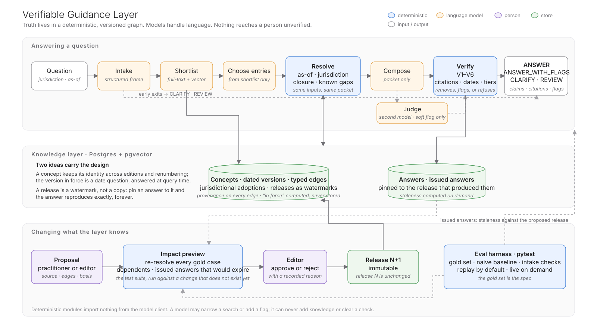
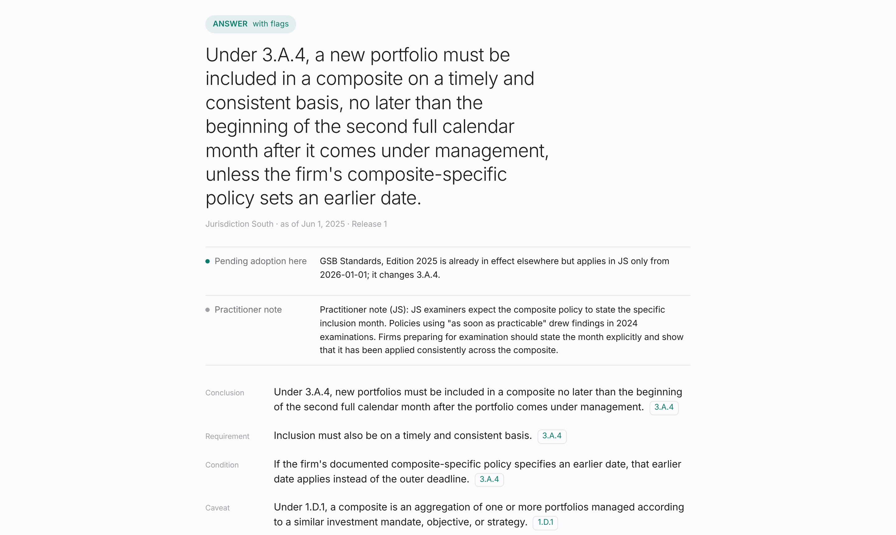

# Verifiable Guidance Layer

A proof of concept for a **verifiable regulatory knowledge layer** — the layer between a
standards body's authoritative guidance and the AI systems that answer questions about it.

> A clause can remain word-for-word identical while the correct answer changes, because a
> definition, exception, or ruling elsewhere has changed.

Retrieval finds relevant text. This layer answers a different question: *does the text that
was found actually support the conclusion, for this jurisdiction, on this date, given
everything else that modifies it?* Truth lives in a deterministic, versioned,
relationship-aware graph; language models handle language; nothing reaches a person
unverified. "The guidance doesn't cover this" is a first-class answer.



## Start here

Ten minutes to the argument; fifteen more to run it; the documents for the rest.

1. **Watch it make its case (seven minutes, nothing to install).** Everything for a reviewer is at
   **[ericediger.com/vgl/review](https://ericediger.com/vgl/review)**: the narrated video, and the
   walkthrough it narrates — **[ericediger.com/vgl](https://ericediger.com/vgl)**, nine chapters of
   recorded output you can step through yourself (press `→` or click): a superseded clause, the
   same question in a different place, the system learning a ruling it did not hold, and a
   definition amendment that changes an issued answer without changing a single provision. The
   same argument on paper: [`docs/vgl-walkthrough.pdf`](docs/vgl-walkthrough.pdf), eleven pages.
2. **Run it yourself (one command, Docker only).** No API keys needed — see *Run it*, below.
   The thirteen recorded questions, both proposal scenes and the release history all work on
   recorded model responses; the deterministic parts are identical either way.
3. **Read, in this order.** [`docs/01-architecture.md`](docs/01-architecture.md) (the design
   and the 0 → 1 path), [`docs/03-decisions.md`](docs/03-decisions.md) (fourteen non-obvious
   decisions, ADR-style), [`docs/eval-report.md`](docs/eval-report.md) (generated results,
   including the honest baseline), and [`docs/00-corpus-spec.md`](docs/00-corpus-spec.md)
   (the fictional corpus everything was built to).
4. **Know what you are looking at.** [`docs/04-demonstration.md`](docs/04-demonstration.md)
   says precisely what on the walkthrough site is recorded and what is simulated (only the
   latency), what runs in this repository with and without keys, how it was built, and what
   a public live deployment would need.

## Deliverables

| | Brief requirement | Where |
|---|---|---|
| **01** | Architecture for a PoC, and 0 → 1 | [`docs/01-architecture.md`](docs/01-architecture.md) |
| **02** | Something concrete | This repository: `docker compose up` and ask it a question. Evidence in [`docs/eval-report.md`](docs/eval-report.md) |
| **03** | Design choices and rationale | [`docs/03-decisions.md`](docs/03-decisions.md), and the commit history |

The specification everything was built to: [`docs/00-corpus-spec.md`](docs/00-corpus-spec.md).
What is recorded, what runs, and how it was built: [`docs/04-demonstration.md`](docs/04-demonstration.md).

## Run it

You need Docker Desktop (or Docker Engine with Compose v2). Nothing else.

**Without API keys** — the model steps replay recorded responses:

```
git clone https://github.com/ericediger/verifiable-guidance-layer.git
cd verifiable-guidance-layer
VGL_LLM_MODE=replay docker compose up --build
```

Then open **http://localhost:8000**. The header shows *recorded responses*. Click any of the
question chips — they are the thirteen cases the layer is tested against — and run the two
scenes from the **Releases** tab (impact preview → approve → ask again on the new release;
**Issued answers** shows the client answer that expires). A question that is not one of the
recorded thirteen returns a plain message saying so rather than an answer.

**With API keys** — ask it anything:

```
cp .env.example .env          # add ANTHROPIC_API_KEY and OPENAI_API_KEY
docker compose up --build
```

First start seeds Release 1 (40 clause versions, 19 relationships, 2 pending proposals).
**Reset to Release 1** is at the bottom of the Releases tab, or `POST /api/reset`. API docs at
`/docs`; health at `/api/health`. Everything in the corpus is fictional — a *Global Standards
Board* shaped like a real standards body, with nothing copied from any real standard.

On Windows, set the variable first: `set VGL_LLM_MODE=replay` (cmd) or
`$env:VGL_LLM_MODE="replay"` (PowerShell), then `docker compose up --build`.

## Test it

```
docker compose run --rm app pytest                       # unit + evals, replayed from fixtures; no network
docker compose run --rm app pytest tests/unit            # the deterministic core alone (< 2 s)
docker compose run --rm app pytest tests/eval --live     # evals against the real models
docker compose run --rm app pytest tests/eval --live --repeat 5   # rates, not pass/fail
```

Tests use their own database (`vgl_test`) and never touch the demo's. The eval session
writes [`docs/eval-report.md`](docs/eval-report.md). The gold set is
[`data/gold.yaml`](data/gold.yaml): *the gold set is the spec*.

## What the demo shows



1. **The traps.** Three questions naive RAG gets wrong in ways that matter — a superseded
   clause, a provision whose meaning moved because a *definition* changed, a carve-out the
   system knows it does not hold — answered with citations to the versions in force, or
   routed for review with the gap named. Side by side with ordinary document RAG over the
   same documents with the same model.
2. **Scene B — the system learns something.** A practitioner proposes the missing Q&A. The
   editor sees the source, the proposed edges, their provenance, and an **impact preview**:
   the gold cases that would change and the client answers that would expire. Approve →
   Release 2. The same question now answers; open Release 1 and it still says REVIEW.
3. **Scene A — the regulation changes.** An amendment to a definition is published. No
   provision changes. The impact preview names the provisions that depend on it and the
   client answer from March that becomes stale on the effective date — with the client's
   reference.
4. **Jurisdiction.** The same question, a different place, a different answer, a pending
   adoption flagged, a practitioner note surfaced and labelled.

The question a careful reviewer asks, and the one the two scenes answer: *did the regulation
change, or did your system learn something it should already have known?* Scene A, Scene B,
and the release history to prove which.

## How it works, in one screen

```
question + jurisdiction + as-of
   → intake        (model: topics, case facts, missing facts — never a date or place)
   → shortlist     (full-text + vector, recall)
   → choose        (model picks entry concepts from titles; validated against the shortlist)
   → RESOLVE       (deterministic: versions in force here on this date, their definitions,
                    interpretations, carve-outs, notes — and every reference that resolves to nothing)
   → compose       (model writes claims bound to version IDs, from the packet only)
   → VERIFY        (deterministic: V1–V6; removes, flags, or refuses)
   → judge         (second model; may add a soft flag, never clears a check)
   → ANSWER · ANSWER_WITH_FLAGS · CLARIFY · REVIEW
```

Knowledge changes only through a proposal → impact preview → editor → immutable release.

## Honest results

From the generated report, on this corpus: 13/13 gold cases pass; every composed claim passed
the structural checks (none had to be removed); 0 of 70 composed citations were to a
superseded version; every expected piece of evidence was in the packet; abstention precision
and recall 100%. The baseline — ordinary RAG over the same prose with the same model, given
the question only — gets most ordinary questions right and fails the three where the right
answer is not simply the newest text applied everywhere, now: a different place, a past date,
an amendment not yet in force — without any way to say which. A baseline given the date and
place in its prompt is the next experiment. On these thirteen cases the layer's advantage is
not more right answers on easy questions; it is zero unflagged wrong answers, and knowing when
not to answer. What is verified, what is not, and what is proposed:
[`docs/01-architecture.md`](docs/01-architecture.md), the last two sections.

## Layout

```
docs/        00 spec · 01 architecture · 03 decisions · 04 demonstration · eval-report · vgl-walkthrough.pdf (+ pdf/ source) · diagrams/
data/        sources/ (prose) · graph/ (structured seed) · proposals/ · gold.yaml
src/vgl/     contracts · db · schema.sql · seed · search · closure · intake · compose
             verify · releases · naive · llm · pipeline · api · config
tests/       unit/ (deterministic) · eval/ (gold, baseline, intake, report) · fixtures/
demo/        the page
```

Working conventions for anyone (or any agent) editing this repo: [`CLAUDE.md`](CLAUDE.md).
