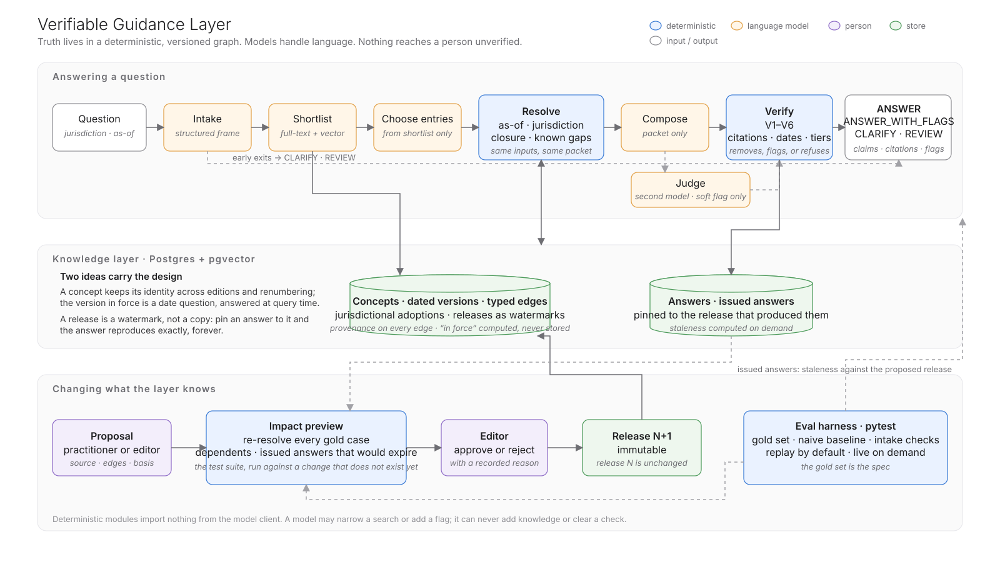

# 01 · Architecture, and the path from 0 → 1

## The problem, restated

The brief describes an assistant that gives confident answers that are wrong in ways that
matter: a clause that has since been amended, a second standard that changes the
conclusion, a ruling that carves out an exception. None of these is a reasoning failure.
They are **knowledge-structure failures**: the model is answering from a flat, unversioned,
relationship-blind pile of text, and nothing checks the answer against anything.

The sharpest form of the problem: **a clause can remain word-for-word identical while the
correct answer changes**, because a definition, exception, or ruling elsewhere has changed.
No amount of better retrieval over the clause's own text can see that.

## The thesis

Four commitments:

1. Truth lives in a **deterministic, versioned, relationship-aware layer**.
2. Language models are used only for language — understanding the question and composing
   the answer.
3. Nothing reaches a person without a deterministic check against the layer.
4. "The guidance doesn't cover this" is a first-class answer, not a failure — the outcome
   that lets the third commitment hold without forcing a guess.

Every probabilistic step is placed *upstream* of a deterministic one that bounds it: a model
may narrow a search or add a flag; it can never add knowledge or clear a check.

**What that assures, precisely.** The layer resolves versioned evidence for a stated
jurisdiction, date and knowledge release; it enforces citation, applicability, authority and
known-gap checks on every claim; and it records the evidence behind each response. It does
not establish that an answer is semantically correct: that still depends on the quality of
the knowledge in the graph, on the right entry concepts being chosen, and on faithful
composition. The checks make the first kind of failure (a citation to text not in force, or
not in the evidence) impossible, and the other kinds visible and attributable. The table at
the end of this document says which parts are implemented, which are implemented with
limits, and which are proposed.

## The components

### Knowledge layer (Postgres + pgvector)

A property graph expressed relationally. Four tables carry the design:

| Table | What it is | The idea |
|---|---|---|
| `concepts` | A stable identity: `prov:composite-inclusion-timing` | Survives editions and renumbering. A concept with no published version is a **known gap** |
| `nodes` | A dated version of a concept, with display reference (`3.A.4` → `3.A.6`), tier, obligation, text, optional machine-checkable parameters | **"In force" is computed, never stored**: the visible version with the latest effective date on or before the as-of date, after the jurisdiction's adoption delay |
| `edges` | Typed, concept-to-concept: `DEPENDS_ON_DEFINITION`, `REFERENCES`, `INTERPRETED_BY`, `CARVED_OUT_BY`, `ANNOTATED_BY` — each with who asserted it, on what basis, from which passage, reviewed by whom | Versions are chosen by date at query time, so an edge never needs re-asserting when an edition changes. Supersession and amendment are *derived* from chronology, not stored |
| `releases` | A watermark: every row records the release that created it and, if retired, the one that retired it | Adding a version in release N+1 closes the previous one *in N+1 only*; release N reproduces byte-for-byte. Answers pin to a release |

Plus `adoptions` (a jurisdiction's effective date for a document), `issued_answers` (what went
to a client, pinned to the versions it relied on), `proposals`, and `chunks` (the same prose,
chunked, for the baseline).

### Answering a question

| Stage | Nature | What it does | What bounds it |
|---|---|---|---|
| Intake | Model, structured output | Question → topics, question type, stated case facts, unresolved items, missing facts | Told never to supply a date or jurisdiction; those are user controls. Code decides CLARIFY: controls missing, or a specific-case question with no facts at all |
| Shortlist | Full-text + vector, RRF | Recall: up to eight candidate concepts | A coverage floor; over-inclusion is allowed |
| Choose entries | Model, from titles only | Precision: one to three entry concepts | Validated in code against the shortlist — it can narrow, never add. Empty → REVIEW |
| **Resolve** | **Deterministic** | Entry concepts → the versions in force for this jurisdiction on this date, their definitions, interpretations, carve-outs, practitioner notes, and every reference that resolves to nothing (gaps). Two SQL statements: a bounded recursive walk, and a per-concept in-force selection | Imports nothing from the model client. Same inputs and release → identical packet |
| Compose | Model, packet only | Atomic claims, each bound to version IDs, plus a one-paragraph summary | Sees only the packet; practitioner notes marked uncitable; unresolved references marked "not held". The claims are what is verified; the summary is the composer's reading of them (see limitations) |
| **Verify** | **Deterministic** | V1 every claim cites · V2 every citation is in the packet · V3 none is superseded · V4 every carve-out is surfaced · V5 an unresolved reference withholds finality · V6 practitioner material never grounds a claim | A bad supporting claim is removed and flagged; a bad conclusion fails to REVIEW. Flags are derived from the packet, not from what the composer chose to mention |
| Judge | Second model, narrow question | Does each claim follow from the texts it cites? | Can add a soft flag; cannot clear a check |

Outcome contract: **ANSWER · ANSWER_WITH_FLAGS · CLARIFY · REVIEW**, meaning, operationally:
ANSWER — every claim passed the declared checks and nothing is outstanding; this is not a
proof that the interpretation is correct. ANSWER_WITH_FLAGS — the same, with a condition or
notice attached (a carve-out, a pending adoption, an upcoming amendment, a practitioner note,
a judge's note). CLARIFY — a control or a required case fact is missing. REVIEW — a failed
check, an unresolved reference, no coverage, or a conclusion that could not be grounded. The
response carries the claims, citations, flags, the full evidence packet, the verification
record, and the release — the same JSON for a person's screen and for an agent's tool call.
An agent gets structured evidence and a review state; what it may *do* with an ANSWER is an
action policy the deploying organisation sets, not something the layer decides.

### Changing what the layer knows

Knowledge enters only through a **proposal** — a bundle of documents, versions and edges with
a named proposer and basis. Before an editor decides, the **impact preview** loads the bundle
inside a savepoint, re-resolves every gold case against the simulated release, walks the
graph backwards to name dependents, computes which issued client answers would expire and
when, and rolls back. It is change detection with no model involved: what evidence and which
dependencies change, and what follows for the gold scenarios and the issued answers. It is not
a proof that the proposed knowledge is correct — that is the editor's question — and it does
not re-run the composed answers. Approval creates release N+1. Rejection is recorded with a
reason.

Staleness of an issued answer is detected when a version it cites gains a successor: the
demonstrated amendment is caught because the answer cites the changed definition. A new
carve-out or relationship that touches a cited provision without replacing a version would
need the same dependency walk the preview already performs for concepts; that is the next
step, not the current behaviour.

Practitioner knowledge has an explicit home and an explicit ceiling: a separate authority
tier, surfaced with its label on every relevant answer, never able to ground a claim.

### Evaluation

The gold set (`data/gold.yaml`) is the specification of correct behaviour, as data. Three
layers in pytest: unit tests with exact expectations for the deterministic core; gold-set
evals asserting structural properties (outcome, citations, hard flags, gaps — never prose
equality) of the probabilistic path, replayed from recorded model responses by default and
run live on demand; and baseline evidence that records what ordinary document RAG does on the
same questions with the same model.

## How the brief's three failures are prevented

| Failure in the brief | Mechanism |
|---|---|
| The clause has been updated and the AI does not know | In-force selection by date; the superseded version is listed as history, never offered as evidence; V3 rejects any citation of it |
| A second standard changes the conclusion | `DEPENDS_ON_DEFINITION` pulls the definition version *in force*, so an unchanged provision resolves against a changed definition; `INTERPRETED_BY` pulls guidance |
| An interpretive ruling carves out an exception the AI is unaware of | If held: `CARVED_OUT_BY` puts it in the packet and V4 forces it to surface. If referenced but not held: the resolver reports a **known gap** and V5 withholds finality — REVIEW with the gap named |

And the rest of what the brief names about the knowledge itself:

| The brief | Mechanism |
|---|---|
| Jurisdictional variations branch the answer | Each jurisdiction's own adoption date selects the version in force; a pending adoption is a flag on the answer |
| Updates to one standard cascade into others that reference it | The reverse walk and the impact preview name every dependent before publication; issued client answers expire with a date and a reason |
| Practitioner knowledge has no authoritative home | A third authority tier: attached to clauses by edge, scoped to a jurisdiction, surfaced with its label on every relevant answer, never able to ground a claim (V6) |
| The ground moves continuously | Releases as watermarks; every answer pinned to one; an earlier release's evidence reproduces exactly, and the answer issued under it is kept |
| Trustworthy for professionals, usable by agents with confidence | Deterministic verification before anything is shown; four outcomes; the same JSON for a person's screen and an agent's tool call, with no path that skips the check |

## 0 → 1

### What the first working version is

This repository. One standards family, two editions that amend and renumber, a definitions
section, one guidance statement, one ruling that arrives by proposal, three jurisdictions
with one delayed adoption, one practitioner note, one issued client answer, one amendment
that arrives by proposal. Forty versions, nineteen edges, thirteen gold cases, five intake
checks. Every mechanism in the design has at least one test that would fail without it.

### What "done" means, and where it stands

From `docs/eval-report.md`, generated by the suite:

| Criterion | Target | Result |
|---|---|---|
| Gold pass rate (layer) | 100% | **100%** (13/13) |
| Composed-claim structural validation rate (claims passing V1–V6 ÷ claims composed) | 100% after verification | **100%** — no claim had to be removed |
| Stale citations | 0 composed, 0 reaching the user | **0 of 70** composed citations were to a superseded version (the packet never offers one); after verification the rate is 0 by construction, since V3 removes any |
| Required gold-evidence coverage (expected versions present in the packet ÷ expected) | 100% | **100%** |
| Modifier surfaced | every carve-out, pending adoption, upcoming amendment flagged | **100%** |
| Abstention precision / recall | REVIEW and CLARIFY when warranted, only then | **100% / 100%** |
| Intake | no invented date, jurisdiction or fact | **5/5** |
| Baseline, given the question only | documented on the same questions | fails **3 of 13** — exactly the cases where the right answer is not the newest text applied everywhere, now (a different place, a past date, an amendment not yet in force) — and cannot say which |

The baseline result is the honest one and the useful one: with a frontier model and a small
corpus, naive RAG gets most ordinary questions right. It fails the three questions where the
right answer is not simply the newest text applied everywhere, now — a different place, a past
date, an amendment not yet in force — because similarity has no representation of place or
time, and it has no way of telling the user which of its answers those are. Three things about
how that was measured. The baseline receives the **question only** — no jurisdiction, no as-of
date — which is how document RAG is usually deployed and is also the point being made; a
baseline given the date and the place in its prompt is the obvious next comparison, and the
first one a reviewer should ask for. Its answers are classified by a simple rubric (cited a
superseded version, stated the wrong month, or reached a conclusion in a forbidden set),
recorded and never asserted. And on the one question where the layer says REVIEW (G4a), the
baseline did better than a generic hedge: it named the missing ruling and advised checking it
— the work the layer does for the reader. On these thirteen cases, the layer's advantage is
not "more right answers on easy questions"; it is **zero unflagged wrong answers, and knowing
when not to answer**.

### What was deliberately left out of version one

- **Extraction at scale.** The structured graph here was authored to match the prose, with
  provenance recorded as if produced by an extractor and reviewed by an editor. Turning
  hundreds of thousands of pages into concepts and edges is the largest piece of work on
  the path to production and the wrong thing to bet a proof of concept on. The design
  assumes a model-assisted extractor whose output enters the graph *only* through the same
  proposal → impact preview → editor path as everything else.
- A graph database. See the decision log; not needed at this scale and the schema already is
  a property graph.
- A judge meta-evaluation (human labels for the judge's verdicts), a jurisdiction-specific
  override that makes a place *stricter* than the global baseline, and multi-user editorial
  roles.

## Decisions made now that constrain or enable what comes next

| Decision | Enables | Constrains |
|---|---|---|
| Stable concept identity with per-version display references | Renumbering, cross-edition citation, answers that survive edition changes | Every ingestion path must resolve text to a concept, not just create a node |
| "In force" computed from dates and adoptions, never stored | Releases that never mutate; historical and future as-of queries for free | Effective dates must be captured at ingestion with care; a wrong date is a wrong answer |
| Releases as watermarks | Reproducible answers; impact preview by simulation; audit | Hard deletes are forbidden; retirement is a release event |
| Provenance on every edge | Accountability; editorial review; the "who said this link exists" question always answerable | Extractors must emit provenance, not just edges |
| Four-state outcome contract with structured claims | Agents can act on the outcome; UIs can show verdicts; evals can assert | Every composer, present or future, must emit claims bound to version IDs |
| Deterministic core cannot import the model client | The trust argument is checkable by reading imports | Any "smart" behaviour in resolve/verify must be expressed as rules or data |
| The graph expressed in SQL | One store for text, vectors, edges and audit; readable by anyone who asks | Multi-hop pattern queries beyond the bounded closure will eventually want a graph store |

## Path to production, briefly

**Scale.** Low millions of versions and tens of millions of edges fit a single Postgres with
read replicas. The closure is shallow by nature (≤ 4 hops) and indexed in both directions;
vectors are a derived index. Move traversal to a graph store only when queries become
pattern-matching across the whole graph, graph algorithms are needed (centrality to
prioritise editorial review), or p95 traversal latency fails despite indexing. The schema
exports to a property graph mechanically; Postgres stays the system of record.

**Ingestion.** Model-assisted extraction of clause boundaries, cross-references, definitions
and effective dates → human review → proposal → impact preview → release. The impact preview
is what makes extraction safe to automate: a wrong edge shows up as changed gold cases and
expiring answers before it is published.

**Agents.** The `/api/ask` response *is* the agent interface: an agent receives the outcome,
the claims, and the packet, and cannot bypass verification because there is no other path.
Wrapping it as a tool (MCP or otherwise) is a thin shim.

**Cost.** The closure bounds the context — the relevant subgraph, not top-k chunks of whole
documents — which is a cost argument for the architecture itself. Composer model is a
config switch; routing by question complexity and caching resolved packets are the obvious
next steps.

**Operations.** Every answer is stored with its frame, packet and verification. Abstentions
and clarifications are a signal to the publisher about where its guidance is hard to apply.

## Honest limitations

- The layer makes errors **visible and attributable**, not impossible. A wrong edge or a
  wrong effective date produces a well-cited wrong answer. The defences are provenance,
  editorial review, impact preview, and the gold set — not the verifier, which checks the
  answer against the graph and cannot check the graph against the world.
- **The summary is not verified.** The rules and the judge check claims; the one-paragraph
  summary is the composer's reading of the kept claims and is shown as such. Deriving it
  from the kept claims is a small change that has not been made.
- Entry selection is probabilistic. It is bounded (it can only choose from what search found)
  and its failure mode is usually a REVIEW or a visibly off-topic packet — but a question that
  lands on the wrong provision will produce an answer about the wrong provision, with correct
  citations to it. Selecting from a shortlist constrains the choice; it does not prove
  relevance.
- Known missing references are detectable (a `REFERENCES` edge to a concept with no version);
  unknown omissions — a ruling nobody has linked — are not.
- The traversal is bounded at four hops as a policy for this corpus, not as a property of
  regulation. A required relationship beyond the bound would be silently absent today;
  reporting incomplete resolution at the boundary is a planned safeguard.
- Edges are timeless and versions carry the dates. Edge validity over time and jurisdictional
  overrides of individual edges are outside the demonstrated scope.
- Reproducibility means three different things, and only the first two are implemented: the
  evidence packet reproduces exactly for fixed inputs and release; the issued answer is stored
  with its packet and verification record and can be retrieved; a *regenerated* composition
  may differ in wording.
- The judge's own precision and recall have not been measured, and a verdict it fails to
  return is treated as "no note" rather than reported as not assessed.
- The corpus is small and fictional. Every number above is a statement about this corpus.

## Implemented, implemented with limits, proposed

| Capability | Status |
|---|---|
| Versioned resolution by jurisdiction, date and release; known gaps as a first-class outcome | Implemented and demonstrated |
| Structural verification V1–V6 with the graded failure contract | Implemented and demonstrated |
| Releases as watermarks; impact preview as change detection | Implemented and demonstrated |
| Practitioner tier with a ceiling (V6) | Implemented and demonstrated |
| Semantic assessment (the judge) | Implemented with limits: soft notes only; not itself evaluated; missing verdicts not reported |
| The summary field | Implemented with limits: composed by the model, not derived from the kept claims |
| Issued-answer staleness | Implemented with limits: successor versions of cited concepts; new relationships need the dependency walk |
| Historical retrieval of issued answers | Implemented: stored with packet and verification; evidence reproduces exactly; regeneration may differ in wording |
| Agent use | Implemented as a contract (the same JSON); an action policy for consequential use is proposed |
| Extraction from prose into the graph, through the proposal path | Proposed; the graph was hand-authored to match the prose |
| Temporal edge validity; jurisdictional edge overrides; incomplete-resolution reporting | Proposed |
| A baseline given equivalent context (date and place in the prompt) | Proposed; the next experiment |
